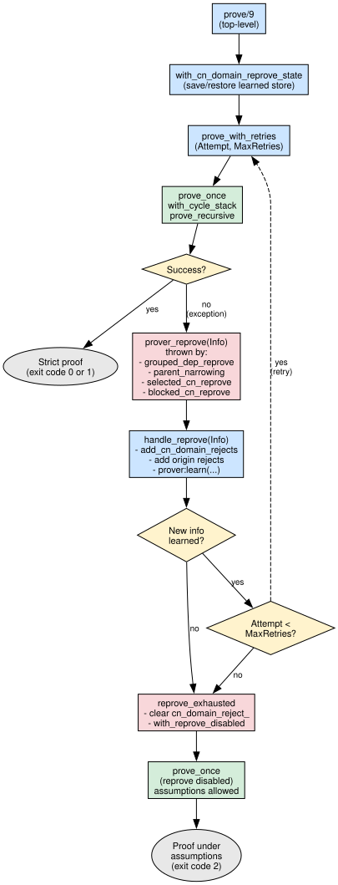
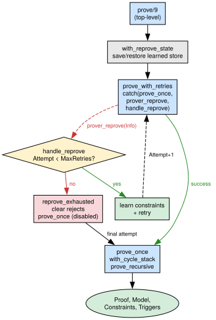
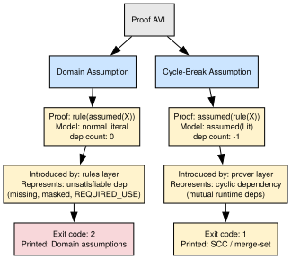
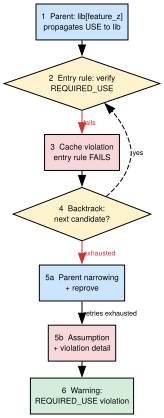
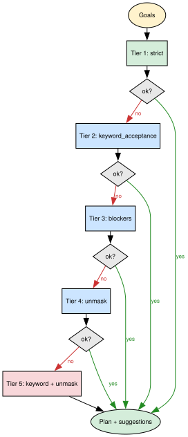

# Assumptions and Constraint Learning

## Always a proof, never a dead end

Most dependency resolvers stop when they cannot satisfy a constraint: no
solution, no plan, and often little more than a terse error.  portage-ng
takes a different stance.  **It does not give up.**  When every
above-board alternative has been exhausted, the prover records an
**assumption** — effectively: “I am proceeding *as if* this dependency
could be satisfied” — and continues building the proof.

The outcome is **always** a complete plan.  Either the proof is **strict**
(no assumptions), or it is a proof **under assumptions**, with the
unresolved fragments called out explicitly.  Assumptions are not
treated as opaque failures; they are **proposals**.  They tell you which
pieces of configuration or tree state would need to change for the same
reasoning chain to become a strict proof.  This is the same habit of mind
as in mathematics: *“Assuming the Riemann hypothesis, we can prove …”* —
the argument is valid *conditional* on the assumptions; make them true,
and the condition disappears.

The sections below walk through a concrete missing-dependency example,
then explain how suggestion tags turn assumptions into actionable hints.
After that, the chapter documents the same mechanisms in technical
detail: assumption taxonomy, reprove loop, REQUIRED_USE flow, entry
rules, constraint guards, progressive relaxation, assumption printing,
and the analogy to conflict-driven clause learning.

## Worked assumption example: missing `dev-libs/foo`

Suppose the user runs:

```text
portage-ng --pretend some-package
```

and some package in the graph depends on **`dev-libs/foo`**, which has **no
ebuild** in any repository the knowledge base knows about.

**What the prover does**

1. The **grouped package dependency** rule tries to prove the dependency
   by enumerating candidates for category `dev-libs` and name `foo`.
2. **Search returns no entries** — there is nothing to install, so every
   candidate path fails.
3. After **backtracking** exhausts those paths, the **fallback chain**
   runs (parent narrowing, reprove with learned domains, and so on, as
   documented below).  None of that invents a missing package.
4. The domain layer finally takes the **assumption path**: it builds a
   condition whose head is `assumed(grouped_package_dependency(…))`, tags
   the proof-term context with a reason (and optional suggestions), and
   the catch-all rule `rule(assumed(_), [])` lets the prover close that
   branch of the proof.

**What appears in the Proof AVL**

The proof tree stores a **domain assumption** with a key of the form
`rule(assumed(Lit))`, where `Lit` is the grouped-dependency literal.  For
example (category and name as atoms, dependency list abbreviated):

```prolog
rule(assumed(grouped_package_dependency('dev-libs', 'foo', …):config?{Ctx}))
    → dep(0, [])?Ctx
```

The exact `Action` (`:config`, `:install`, `:run`, …) depends on which
phase of the grouped dependency is being proved; the important invariant
is the **`rule(assumed(...))`** proof key (see [Assumption Taxonomy](#assumption-taxonomy)).

**What the user sees in the plan output**

The printer classifies this as a non-existent dependency and emits a
**Domain assumptions** block, along the lines of:

```text
Domain assumptions: dev-libs/foo (non-existent)
```

**Exit code**

When any **domain** assumption is present, the CLI exit code is **`2`**
(cycle-break-only assumptions alone yield **`1`**; a fully strict proof
yields **`0`**).

**How to read it**

The message is intentionally operational: **to resolve this assumption,
ensure `dev-libs/foo` is available in your repository** (overlay,
third-party tree, or corrected package name).  The plan is still a
single coherent merge order; the assumption marks the gap between what the
prover can justify from facts and what you must supply from outside.

## Assumptions as actionable proposals

Many assumptions carry **`suggestion(Type, Detail)`** (and related) tags
in the literal’s **`?{Context}`** list.  These encode **configuration
changes** that would move the proof toward strictness — often the same
changes the **progressive relaxation** tiers simulate when you widen
`assuming/1` flags.

Typical shapes in the codebase include:

| **Tag (representative)** | **User-facing intent** |
|:---------------------|:-------------------|
| `suggestion(keyword, '~amd64')` | Accept the unstable keyword — e.g. add to **`package.accept_keywords`** (in sources: `suggestion(accept_keyword, '~amd64')`) |
| `suggestion(unmask, …)` | Unmask the package — e.g. **`package.unmask`** (`Repo://Entry` when known) |
| `suggestion(use, …)` | Adjust USE flags — e.g. **`package.use`** (in sources: `suggestion(use_change, Repo://Entry, Changes)`) |

When you run in modes that **apply** suggestions (see the builder’s
`execute_suggestion/…` hooks), those changes are **already reflected in
the plan**; your job is to **review and approve** them in your real
`/etc/portage` layout, or to treat the tags as a checklist for manual
edits.  [Progressive Relaxation](#progressive-relaxation) ties the same
ideas to the `assuming` tiers (`keyword_acceptance`, blockers, `unmask`).

## Overview



The portage-ng prover builds a formal proof that a set of target packages
can be installed.  The proof is an AVL tree mapping literals to their
justifications.  When part of the dependency graph cannot be satisfied,
the prover records *assumptions* — lightweight markers that let the proof
complete while flagging the unresolved fragment for the user.

Two fundamentally different kinds of assumptions exist, and a bounded
reprove mechanism allows the prover to retry the proof with accumulated
knowledge before resorting to assumptions.



## Data Structures

The prover maintains four AVL trees during proof construction:

| **AVL** | **Key → Value** | **Purpose** |
| :----------- | :------------------------------------ | :----------------------------------- |
| Proof     | `rule(Lit)` → `dep(N, Body)?Ctx`   | Which rule justified Lit          |
| Model     | `Lit` → `Ctx`                      | Every proven literal + context    |
| Constraints | constraint key → value           | Accumulated constraint terms      |
| Triggers  | `BodyLit` → `[HeadLit, …]`        | Reverse-dependency index          |

## Assumption Taxonomy



The two kinds of assumptions are stored differently in the Proof and
Model trees.  Confusing them leads to wrong statistics, wrong plan
output, or missed warnings.

### Domain Assumptions (`rule(assumed(X))`)

Introduced by the **rules layer** when a dependency cannot be satisfied
— for example, a package that does not exist in the tree, or a
REQUIRED_USE violation that makes every candidate invalid.

**How they are created:**

The `grouped_package_dependency` rule exhausts all candidates (via
Prolog backtracking), then the fallback chain (parent narrowing →
reprove → assumption), and finally emits:

```prolog
Conditions = [assumed(grouped_package_dependency(C,N,Deps):Action?{Ctx})]
```

The `assumed(X)` literal in the body is proved by the catch-all rule:

```prolog
rule(assumed(_), []) :- !.
```

This stores `rule(assumed(X))` in the Proof tree.

**Where they appear:**
- Proof: `rule(assumed(X))` → `dep(0, [])?Ctx`
- Model: `assumed(X)` → `Ctx` (the `assumed(X)` body literal is proved
  as a regular literal; exit-code detection scans for these keys)
- Plan: rendered as "verify" steps + "Domain assumptions" warning block

### Prover Cycle-Break Assumptions (`assumed(rule(X))`)

Introduced by the **prover** when it detects a cycle during proof
search.  If a literal is already on the cycle stack (currently being
proved), the prover cannot recurse further without diverging.  Instead,
it records a cycle-break:

```prolog
put_assoc(assumed(rule(Lit)), Proof, dep(-1, OldBody)?Ctx, Proof1),
put_assoc(assumed(Lit), Model, Ctx, NewModel)
```

**Where they appear:**
- Proof: `assumed(rule(Lit))` → `dep(-1, Body)?Ctx`
- Model: `assumed(Lit)` → `Ctx`
- Plan: ordered normally by the ordering pass; cycle explanation via
  the printer's cycle section (`Printer/Plan/cycle.pl`)

### Summary Table

| **Property** | **Domain Assumption** | **Prover Cycle-Break** |
| :------------------------ | :---------------------------- | :---------------------------- |
| Proof key              | `rule(assumed(X))`         | `assumed(rule(X))`         |
| Model key              | `assumed(X)`               | `assumed(Lit)`             |
| dep count              | 0                          | -1                         |
| Introduced by          | rules layer                | prover layer               |
| Represents             | unsatisfiable dependency   | cyclic dependency          |
| Printed as             | "Domain assumptions"       | cycle break                |
| Exit code contribution | 2                          | 1                          |

## Reprove Mechanism

When a conflict is detected during proof search, the domain layer does
not simply fail — it records what went wrong and requests a retry with
refined knowledge.

### Triggering Reprove

Several predicates can throw `prover_reprove(Info)`:

| **Source** | **When** |
| :--------------------------------- | :--------------------------------------------- |
| `maybe_learn_wildcard_domain`   | Wildcard dep fails and parent already narrowed or single-version; learns upper-bound `cn_domain` from wildcard |
| `maybe_learn_parent_narrowing`  | Parent introduced a dep that made (C,N) unsatisfiable; rejects the exact parent entry |
| `maybe_request_grouped_dep_reprove` | Effective domain conflicts with selected CN; domain inconsistent; version/slot constraints present |
| `selected_cn_unique_or_reprove` | CN-domain constraint conflicts with already-selected candidate (constraint guard) |
| `selected_cn_not_blocked_or_reprove` | Blocker detected via blocked source snapshot |

Each throws `prover_reprove(cn_domain(C, N, RejectDomain, Candidates, Reasons))`.

### Handling Reprove

When `prove_with_retries` catches a `prover_reprove(Info)` exception,
it delegates to `heuristic:handle_reprove/2`.  The exchange proceeds in
four steps:

1. **Record what went wrong.**  The handler extracts the conflicting
   category, name, domain, and candidate list from `Info` and adds
   them to a reject set (`memo:cn_domain_reject_`).  If the conflict
   was introduced by a specific parent, that origin is also recorded
   so the prover avoids the same path on the next attempt.

2. **Decide whether to retry.**  If new information was actually
   learned (`Added = true`) and the attempt count is still below
   `reprove_max_retries`, the handler restarts the proof from scratch
   by calling `prove_with_retries` with an incremented attempt
   counter.  The learned rejects carry over, so the prover will not
   repeat the same conflict.  A wildcard domain learned by
   `maybe_learn_wildcard_domain` counts as new information: it has no
   candidate to reject, the narrowed learned domain is the progress.

3. **Concede a conflict that has no solution.**  If nothing new was
   learned, the same conflict would come back on every attempt.  The
   prover offers it to `heuristic:reprove_concede/1`, which concedes
   the package the conflict is about (`cnselect:concede_conflict/1`):
   its conflicts are no longer raised, so the next attempt records the
   conflict as an assumption and goes on repairing the conflicts about
   every other package.  This costs one attempt.  See
   *Conceding a conflict* below.

4. **Give up gracefully.**  If the conflict cannot be conceded (it was
   conceded before, or it names no package), or the retry budget is
   exhausted, the handler calls `reprove_exhausted`, which **clears**
   the reject set so the final attempt runs unbiased.  It then invokes
   `prove_once` with reprove **disabled** — no further
   `prover_reprove` exceptions can be thrown, so the proof completes
   with assumptions where necessary.

### Conceding a conflict

Some conflicts have no solution in the tree.  `app-text/pandoc-2.18-r2`
needs `<dev-haskell/aeson-2.1`; the only such `aeson` needs
`<dev-haskell/primitive-0.8`, and it also needs `dev-haskell/scientific`,
whose only version needs `>=dev-haskell/primitive-0.9`.  Parent
narrowing answers such a conflict by climbing: it rejects `scientific`,
then every `aeson` (none is left without `scientific`), then the
consumers of `aeson`, until it reaches a package that has no other
version to offer — the root target at the latest.  There the reject
changes nothing and the loop stalls.

Before conceding existed, a stall ended the loop: the final pass ran
with reprove disabled, and every conflict it was the first to meet
became an assumption as well.  `pandoc-2.18-r2` was reported with
conflicts on `ghc`, `text`, `tls`, `vector`, `zlib` and `data-default`
that rejecting one candidate repairs.

`cnselect:concede_conflict/1` instead undoes the stalled climb and
nothing else:

- The stalled package and every package the climb went through
  (`memo:cn_narrowed_for_/6` records which entry each parent-narrowing
  reject was made of, and for which dependency) are marked conceded
  (`memo:cn_domain_conceded_/3`).  `cnselect:request_reprove/1` raises
  no conflict about a conceded package.
- Their rejects are dropped, so the next attempt selects them again
  and records the one dependency the climb started from as the
  assumption.
- Their learned `cn_domain` constraints go back to what they were at
  the start of the pass in which the climb took its first step
  (`prover:learned_snapshot/2`, `prover:learned_restore/2`).  The climb
  selected versions the plan does not end up with, and a domain learned
  under such a version would otherwise stay with nothing left to
  correct it.  What was learned in earlier passes is kept.  That one
  pass serves every package of the climb (`cnselect:climb_before/4`):
  a domain can be learned for a package before any narrowing names it.
  Taking each package back to the pass in which a narrowing first
  named it was measured and rejected: no target better, one worse
  (`dev-haskell/criterion-1.5.11.0`, 6 to 8 `unsatisfied_constraints`
  entries), and `dev-haskell/statistics-0.15.2.0` took three times the
  inferences for the same plan.
- Nothing more is learned for a conceded package
  (`cnselect:learn_cn_domain/5`), and it takes no further rejects.

Re-rejecting a candidate that a wider reject key already covers is not
reported as progress (`cnselect:add_cn_domain_rejects/5`), so a stall
is recognised on the attempt it happens.

Two things keep a concession to what stalled:

- **Slots.**  A package with candidates in several slots is conceded
  one slot at a time, when the stalled conflict is about one slot
  (`cnselect:conflict_slot/4`: the slot its domain is scoped to, the
  slot its candidates share, or the slot a dependency without any
  candidate asks for).  `sys-devel/clang-crossdev-wrappers-16` depends
  on `llvm-core/clang:16`, which the tree no longer has; that says
  nothing about the other clang slots, whose conflicts are still
  repaired.  A package with one slot is always conceded as a whole.
  The packages below the stalled one in a climb are conceded as a
  whole too: the narrowing record does not say which slot was asked
  for.
- **Settled narrowing.**  A stall that names a domain asks for a
  version in that domain.  A version of the stalled package outside it
  (or outside the conceded slot) could not have served the consumer
  that is stuck, so an earlier narrowing that rejected such a version
  is not a step of this climb (`cnselect:stalled_record/3`): the
  version stays rejected, the dependency it was rejected for is not
  conceded, and its pass does not count as the start of the climb.  A
  stall that names no domain gives nothing to tell the narrowings
  apart by, and all of them are followed.  Following only the
  narrowing of the candidates such a stall names was measured and
  rejected: 4 targets worse, 1 mixed, none better
  (`kde-frameworks/ktexteditor-6.29.0` from no NEGATIVE assumptions to
  39).

Both are neutral on today's tree: no plan changes.  Four packages with
several slots are conceded tree-wide (`llvm-core/clang`,
`llvm-core/lld`, `llvm-runtimes/clang-runtime`,
`media-video/ffmpeg-chromium`, nine concessions), and none of the 49
stalls that name a domain has a narrowing outside it.

Tree-wide (33,749 ebuilds, `resolver:test_stats`) conceding removed 221
NEGATIVE `unsatisfied_constraints` assumptions and 15 `issue_with_model`
assumptions; 44 targets improved, 12 of them to a plan without NEGATIVE
assumptions, none got worse, for 1.3% more inferences.

### Alternative proofs

Conceding limits what one unsolvable conflict costs, but the loop never
reconsiders which side of a conflict it kept.  The first conflict about
a package learns the narrower domain and rejects the candidate that was
selected; every later step builds on that.  When the target has no
clean solution, that first choice decides how many dependencies end up
assumed.  `dev-haskell/xml-hamlet-0.5.0.1` needs `<dev-lang/ghc-9.1`.
The bound was learned, `ghc-9.8.4` was rejected, and the plan reported
twelve dependencies of other packages that no `ghc-9.0` world
satisfies.  Giving up the one `<ghc-9.1` instead leaves two
assumptions (install and run of that one dependency), which is also
what `emerge` reports as the conflict.

Only a complete proof shows the whole price of a decision, so this is
decided after the loop, by comparing complete proofs
(`prover:prove_best/10`):

1. The retry loop produces its proof as before.
2. If a conflict was conceded and the proof has at least two
   different conflicts, `heuristic:reprove_alternatives/4` names
   packages to hold to another candidate
   (`cnselect:overrule_alternatives/3`).  Conflicts are counted, not
   assumption entries (`heuristic:proof_conflicts/2`): an assumed
   dependency is one conflict per consumer and package, however many
   entries list it (install and run, several proof contexts), and
   every other domain assumption that is not a blocker record is one
   by itself.  A proof with one conflict is left alone: the other side
   of a single conflict costs one conflict as well (`pandoc-2.18-r2`
   above).
3. For each alternative, `cnselect:overrule_begin/3` empties the
   rejects, concessions and the learned store — all of it answered the
   candidate now given up — and holds the package to the named
   candidate (`memo:cn_overruled_/3`).  The package is conceded, so a
   dependency that candidate does not satisfy becomes an assumption
   instead of a conflict.  The retry loop then runs again from the
   original inputs.
4. The alternative's proof is kept when it is strictly cheaper
   (`heuristic:proof_cost/2`, see *What a proof costs* below).  The
   search then continues from the kept proof, so a second
   change of mind can build on the first: with what the kept proof
   gives rise to, followed by the alternatives named earlier and not
   tried yet (`heuristic:reprove_alternatives/4`).  Otherwise the hold
   is withdrawn, and with it the concession and the exact-version pin
   it came with (`heuristic:alternative_end/2`,
   `cnselect:overrule_drop/2`).

The retry loop's own proof is committed to before the first alternative
is proven.  A loop that ran out of retries ends inside
`prover:with_reprove_disabled/1`, and that scope only closes when the
choicepoints of its pass are dropped; without the commit every
alternative would run with reprove disabled, one pass each and no
conflict repaired.

Two readings of a completed proof name a package and a candidate:

- **Majority.**  The package was conceded, as a whole or in one slot,
  and another candidate satisfies more of the dependencies the proof
  has on it than the selected one.  `dev-ml/ppx_bench-0.17.0-r1` goes from thirteen
  assumptions to two this way: what is left is the one
  `<dev-ml/ppxlib-0.36.0` (install and run) that the candidate most
  consumers accept, `ppxlib-0.39.0`, does not satisfy.
- **Reversal.**  The package has a learned domain, and a consumer was
  narrowed for it or it was conceded.  The candidate is the best-ranked
  one the domain
  excludes, which is what a proof without that domain selects.  The
  dependencies in the proof say little here, because its packages were
  selected to fit the learned domain; that is why this reading does
  not count them and relies on the comparison of the two proofs.
  `xml-hamlet-0.5.0.1` above is repaired by this reading.

A package whose candidates span several slots and the package of a
root target are never overruled.

**What a proof costs.**  `heuristic:proof_cost/2` returns
`cost(Negative, Positive, Blockers, Benign, Entries)`, compared left to
right, smaller is cheaper:

| Component | Counts |
| :-------- | :----- |
| `Negative` | different conflicts among the NEGATIVE domain assumptions (`assumption:assumption_polarity/2`) |
| `Positive` | different conflicts among the POSITIVE ones (unmask, accept a keyword) |
| `Blockers` | blocker records that hit something in the plan (`annotation:effective_blockers/2`) |
| `Benign` | cycles: the prover's cycle breaks and the domain's |
| `Entries` | domain assumptions as the proof lists them, blocker records aside |

A conflict is a consumer and the package it depends on.  The proof can
list one conflict several times: once per phase (install, run), once
per grouped dependency, and once more for every proof context the
consumer was proven under.  `dev-ml/ppx_let-0.17.0-r2` lists
`<dev-lang/ocaml-5.3`, required by `ppxlib-0.33.0-r2`, five times.
Conflicts therefore come before entries; counting entries first chose
two conflicts in four entries over one conflict in six
(`dev-ml/ppxlib_jane-0.17.2-r2`).  NEGATIVE comes first, so an
alternative never trades something the user can configure away for
something that cannot be satisfied.  The soft blockers a proof merely
walks past are counted nowhere.

**What an alternative may spend.**  The alternatives of one prove share
one retry budget, `reprove_max_retries`: each takes what it used, and
one that runs out takes all of it.  Later alternatives then get a
single pass, which is enough for one that meets no conflict
(`xml-hamlet-0.5.0.1`: holding `cabal` exhausts the budget, holding
`ghc` is then proven in one pass).  An alternative that runs out is
abandoned rather than finished with reprove disabled
(`prover:prove_alternative/8`): that pass turns every conflict it
meets into an assumption, so its proof says little about the
alternative.  `kde-plasma/plasma-meta-6.7.5` has two alternatives that
each exhausted a full budget and gained nothing; sharing the budget
took it from 278M to 193M inferences (114M without alternatives).

An error (`error(_, _)`) inside an alternative is reported once
(`Ignored error in alternative proof: ...`) and costs that alternative
only; the proof of the retry loop is there to return.  The time limit,
`request_exit(_)` and an abort are not errors of the alternative and
pass through, after the alternative's hold has been withdrawn like
that of any alternative that is not kept.

`config:reprove_max_alternatives/1` (default 2) bounds the number of
alternative proofs per prove; 0 switches the search off.  Only a
strictly cheaper proof replaces the loop's own, so the number of
NEGATIVE conflicts cannot go up.  Tree-wide (33,749 ebuilds,
`resolver:test_stats`) the search removed 143 NEGATIVE
`unsatisfied_constraints` entries; 20 targets improved for 0.8% more
inferences.  One target lists more entries than before for fewer
conflicts (`ppxlib_jane-0.17.2-r2`: six entries for one conflict,
where the loop's proof had five for two).  None of the targets became
installable: their conflicts are real, and the plan now reports the
conflict rather than its consequences.

### Learned Constraint Store

The `prover:learn/3` and `prover:learned/2` predicates maintain a
key-value store that **persists across reprove retries** within the same
top-level `prove/10` invocation.  This is distinct from the reject set
(which accumulates and is cleared on exhaustion).  A constraint leaves
the store in one case only: conceding a stalled climb puts the learned
domains of the conceded packages back to an earlier snapshot (see
*Conceding a conflict* above).

The domain uses learned constraints for:

- **Candidate narrowing** — `grouped_dep_effective_domain` intersects
  the local+context domain with any learned domain.
- **Conflict learning** — constraint guards learn the domain when a
  conflict is detected.
- **Parent narrowing** — `maybe_learn_parent_narrowing` excludes the
  parent version when a child dep cannot be satisfied.  This one does
  *not* go through the learned store: a version domain cannot express
  a hole, and a `< ParentVer` cut would also discard every newer parent
  version that was still eligible.  The exact parent entry is placed in
  the reject map instead.
- **Wildcard failure learning** — `maybe_learn_wildcard_domain` derives
  an upper-bound domain from a wildcard constraint (e.g. `=pkg-0.6*`
  → `< 0.7`) when parent narrowing alone could not resolve the
  conflict.

### Retry Budget

`reprove_max_retries` defaults to 20 (configurable via
`config:reprove_max_retries/1`).  A conceded conflict uses one attempt
of this budget.  The final attempt runs with reprove disabled so the
proof can complete with assumptions if necessary.
Before it runs, `heuristic:reprove_exhausted/0` clears the reject map
(including the parent-narrowing rejects) so the final pass starts from
a clean candidate set; only the learned constraint store survives.
Keeping the parent-narrowing rejects alive across exhaustion was
measured tree-wide and rejected: it fixed 3 targets but added NEGATIVE
assumptions in 48 and changed them in 75 more.

A target that asks for an old version of a package set which the tree
has since moved on from (`kde-plasma/plasma-meta-6.7.5` next to the
6.8.2 set) moves one package per attempt and can still run out of
budget; the conflicts left at that point are reported as assumptions.

The alternative proofs that follow the loop share one more budget of
the same size between them (see *Alternative proofs* above).

## Use model violation flow

When a parent package forces USE flags on a dependency via bracketed USE
deps (e.g. `cat/pkg[feature]`), and the dependency's `REQUIRED_USE`
forbids that flag combination, the REQUIRED_USE violation mechanism
ensures the prover explores alternatives before assuming.

### Step-by-step flow

{width=42%}

The diagram above shows the six stages the prover walks through when
a parent forces a USE flag that violates a dependency's REQUIRED_USE.
Each step is explained below.

**Step 1 — USE propagation.**
The parent atom `cat/app` depends on `cat/lib[feature_z]`.
The bracketed flag is carried forward as a `build_with_use` context
annotation, so every candidate version of `lib` will be evaluated with
`feature_z` enabled.

**Step 2 — Entry rule verification.**
When `lib`'s `:install` (or `:run`) entry rule fires, it computes the
full USE model and calls `use:verify_required_use_with_bwu` to check
whether the resulting flag set satisfies `lib`'s `REQUIRED_USE`
expression.

**Step 3 — Fail, not assume.**
If verification fails (e.g. `lib` declares `REQUIRED_USE=!feature_z`),
the entry rule caches a structured violation description via
`memo:requse_violation_/3` and then **fails**.  It does *not* produce an
assumption, because doing so would hide the failure from the candidate
selection logic and bypass the entire reprove mechanism.

**Step 4 — Candidate backtracking.**
The failure propagates back to `grouped_package_dependency`, which tries
the next candidate version of `lib`.  A different version may have a
different `REQUIRED_USE` that does not conflict with `feature_z`.

**Step 5a — Parent narrowing + reprove.**
When all candidates are exhausted, the fallback chain activates.
`maybe_learn_parent_narrowing` rejects the current parent entry
(`app-1.0`) and throws `prover_reprove`, giving the prover a
chance to retry with a different parent that may not force `feature_z`.

**Step 5b — Assumption with violation detail.**
After all reprove retries are exhausted, the prover falls through to the
assumption path.  `explanation:assumption_reason_for_grouped_dep`
retrieves the cached `requse_violation_` info and enriches the
assumption context with a `required_use_violation(...)` tag.

**Step 6 — Warning output.**
The printer recognises the enriched context and emits a structured
REQUIRED_USE violation warning, showing which flags were forced, what
expression they violate, and which parent triggered the conflict.

### Memo cache

The violation info is cached via `memo:requse_violation_/3` (thread-local,
survives backtracking since `assertz` is side-effecting).  It is:
- **Asserted** in the entry rule before failing
- **Consumed** in the `grouped_package_dependency` assumption path
  (retracted after enriching the context)
- **Cleared** by `memo:clear_caches/0` at the start of each proof run

## Entry rule structure

Every `:install` and `:run` entry rule follows the same layered
structure.  Understanding this structure is important because it
explains *when* the prover fails, *when* it assumes, and *why* the
distinction matters.

**Gate checks.**
The rule begins with a deterministic cut (`!`) — there is exactly one
entry-rule clause per literal form, so Prolog must not search for
alternatives at this level.  Candidate alternatives are provided one
level up by `grouped_package_dependency`.  After the cut, three quick
gate checks run in order:

1. **Mask gate** — if the ebuild is masked and the `unmask` relaxation
   tier is not active, the rule fails immediately.
2. **Keyword gate** — if no accepted keyword exists and
   `keyword_acceptance` is not active, the rule fails.
3. **Already-installed short-circuit** — if the package is already
   installed (and `--emptytree` was not requested) with USE flags that
   match the request, the rule succeeds with an empty condition list.
   When the installed USE differs, the entry is re-emitted as a
   transactional `:update` action instead (portage-ng#85).

**USE model verification.**
When none of the gates apply, the rule queries the ebuild's metadata
and computes the full USE model (combining profile defaults,
user overrides, and `build_with_use` annotations from the parent).
It then checks the result against the ebuild's `REQUIRED_USE`
expression.  If the check fails, the violation is cached
(`memo:requse_violation_/3`) and the rule fails — *not* assumes — so
that backtracking can explore other candidate versions (see section
9.8.1).

**Dependency model construction.**
If the USE model passes, the rule builds the dependency model:
it looks up cached or freshly computed dependency lists, orders them,
and returns the full condition list (selected CN, constraints,
download literal, dependency literals, etc.).

If the dependency model itself cannot be built — for example because
every branch of an `any_of_group` is filtered out — the rule produces
a domain assumption tagged with `issue_with_model`.  This is
deliberately an assumption rather than a failure, because the problem
is intrinsic to the ebuild metadata, not something that trying a
different candidate version would resolve.

## Constraint guards and reprove integration

Every time the prover unifies a new constraint term into the proof, it
calls `heuristic:constraint_guard(Key, Constraints)` to verify that the
constraint is consistent with what has already been proved.  The guard
has three possible outcomes:

- **Succeed silently** — the constraint is compatible and the proof
  continues normally.
- **Fail** — the constraint conflicts with the current proof state.
  Prolog's built-in backtracking explores an alternative within the
  same proof attempt (e.g. a different candidate version).
- **Throw `prover_reprove(...)`** — the conflict cannot be resolved by
  simple backtracking.  The prover catches the exception, records a
  learned constraint, and restarts the proof from scratch with the new
  knowledge (see section 9.7).

Three specialised guards in `cnselect.pl` cover the most common
conflict types:

- **`selected_cn_unique_or_reprove`** checks that the selected
  category/name pair is consistent with prior selections.  If two
  dependency paths select different versions of the same package in the
  same slot, this guard detects the inconsistency and triggers a
  reprove with a narrowed domain.
- **`selected_cn_not_blocked_or_reprove`** enforces blocker
  constraints.  When a package is blocked by another package that has
  already been selected, this guard triggers a reprove so the prover
  can learn to avoid the blocked combination.
- **`maybe_request_cn_domain_reprove`** handles remaining domain
  inconsistencies.  If the selected version falls outside the
  intersection of all accumulated version domains, the guard learns
  the correct domain and triggers a reprove.

The constraint guards above operate within a single proof attempt.
But what happens when the entire proof cannot succeed under strict
constraints?  Rather than immediately falling through to assumptions,
the pipeline offers one more tool: progressive relaxation.

## Progressive Relaxation



Not every dependency graph can be satisfied under the strictest
interpretation of the repository metadata.  A package may exist only
with an unstable keyword, or be masked by the profile, or conflict with
an already-installed blocker.  Rather than giving up at the first such
obstacle, the pipeline applies **progressive relaxation**: it re-runs
the entire proof under successively weaker constraints until a complete
plan emerges.

The mechanism lives in the pipeline's shared fallback driver
(`pipeline:fallback_tiers/1` + `pipeline:with_fallback/2`), used by both
`prove_plan_with_fallback/5` and `prove_with_fallback/4`.  Each
tier wraps the prover call inside `prover:assuming/2`, which sets a
dynamic flag that the domain rules consult at decision points.

| **Tier** | **`assuming` flag** | **What is relaxed** |
|:-----|:----------------|:----------------|
| 1 (strict) | none | All masks, keywords, and blockers enforced |
| 2 | `keyword_acceptance` | Unstable keywords (`~amd64`) accepted |
| 3 | `blockers` | Blocker constraints downgraded to warnings |
| 4 | `unmask` | Masked packages unmasked |
| 5 | `keyword_acceptance` + `unmask` | Both relaxations combined (last resort) |

The tiers are tried in order via Prolog's committed-choice
if-then-else (`->` / `;`) — the first tier that succeeds commits
and returns a `FallbackUsed` tag (`false`, `keyword_acceptance`,
`blockers`, `unmask`, or `keyword_unmask`).

The same 5-tier fallback chain is shared by two canonical entry
points in the pipeline module:

- `prove_plan_with_fallback/5` — full pipeline (prove + order),
  used by production paths (`--pretend`, `--graph`, `--build`).
- `prove_with_fallback/4` — resolve pass only (no ordering pass), used
  by layered tests (`resolver:test`, `orderer:test`)
  and `--bugs`.  Each test layer adds its own stages on top.

### How `assuming/2` works

`prover:assuming(Flag, Goal)` asserts a thread-local fact
(`prover:assuming_(Flag)`) for the duration of `Goal`, using
`setup_call_cleanup` to guarantee cleanup even on exceptions.  A nested
activation of a flag that is already active just runs `Goal`: it pushes
no second fact and retracts nothing on the way out, so the outer
activation stays in force.  Domain predicates test this flag with the unary
`prover:assuming(Flag)`:

- **`candidate:eligible/1`** — when `keyword_acceptance` is active,
  candidates with any keyword are accepted; when `unmask` is active,
  masked candidates pass.
- **`acceptance:accepted_keyword_candidate/7`** — two fallback clauses
  widen the candidate pool: one for unstable keywords, one for masked
  packages.
- **`candidate:assume_blockers/0`** — returns `true` when blocker
  constraints should become warnings instead of hard failures.

### Suggestion tags

When a relaxation flag is active and a candidate is admitted under that
relaxation, the domain tags the literal's context with a
**`suggestion/2`** term that records exactly which configuration change
would eliminate the need for the relaxation:

| **Suggestion tag** | **Meaning** | **Target file** |
|:---------------|:--------|:------------|
| `suggestion(accept_keyword, '~amd64')` | Accept the unstable keyword | `package.accept_keywords` |
| `suggestion(unmask, R://E)` | Unmask the package | `package.unmask` |
| `suggestion(use_change, R://E, Changes)` | Adjust USE flags | `package.use` |

These tags flow through the proof into the plan output.  In builder
mode, `builder:dispatch_suggestions/3` can apply the suggestions
automatically (writing to `/etc/portage/package.*` files); in pretend
mode, they appear as actionable hints in the plan output.

### Formal guarantee

Each tier still produces a **complete proof** — the plan is always
coherent and fully ordered.  The relaxation only widens the candidate
pool; it does not skip proof obligations or bypass constraint guards.
The suggestion tags make it possible to **trace back** every relaxation
to a concrete configuration change, so the weaker proof can be
strengthened incrementally.

Once the proof is complete — whether strict or under assumptions —
the results must be communicated to the user.  The assumption printing
pipeline inspects the Proof AVL and translates each assumption into a
classified, actionable message.

## Assumption printing pipeline

After the proof is complete, the printer walks the Proof AVL and
collects every entry that represents an assumption.  Assumptions fall
into two families, and the printer handles them differently.

**Domain assumptions** are stored under `rule(assumed(X))` keys.  These
represent situations where the prover could not find a real rule and
had to accept the literal on faith.  When the printer encounters one,
it inspects the literal and its context to classify the assumption and
produce a meaningful message:

- **REQUIRED_USE violation** — the context contains a
  `required_use_violation(...)` tag (see section 9.8.1).  The printer
  emits a structured block showing which USE flags were forced, which
  `REQUIRED_USE` expression they violate, and which parent caused the
  conflict.
- **Non-existent dependency** — the literal is a
  `grouped_package_dependency` without context.  This means no
  candidate version exists at all (the category/name is not in the
  repository).
- **Grouped dependency with reason** — the literal is a
  `grouped_package_dependency` with an `assumption_reason` tag in its
  context.  The printer extracts the reason label (e.g. "all candidates
  masked", "blocker conflict") and shows it alongside the dependency.
- **Model unavailable** — the context contains `issue_with_model`.
  The dependency model could not be built (e.g. all `any_of_group`
  branches were filtered).  The printer reports this as a metadata
  problem.
- **Generic** — any domain assumption that does not match the above
  patterns is printed with the raw literal for debugging.

**Cycle-break assumptions** are stored under `assumed(rule(X))` keys.
These mark points where the prover broke a dependency cycle by assuming
a literal that was already being proved.  The printer delegates to
`cycle:print_cycle_explanation`, which reconstructs the cycle path and
explains which packages form the loop.

### Assumption type classification

The classification logic lives in `assumption.pl`.  Given an assumption
literal and its context, it returns a type tag that the warning printer
uses to select the appropriate output format:

| **Pattern** | **Type tag** |
| :--- | :--- |
| Context contains `required_use_violation` | `required_use_violation` |
| `grouped_package_dependency` (no context) | `non_existent_dependency` |
| `grouped_package_dependency` (with context) | Extracted from `assumption_reason` |
| `R://E:install` | `assumed_installed` |
| `R://E:run` | `assumed_running` |
| Blocker literal | `blocker_assumption` |
| Context contains `issue_with_model` | `issue_with_model` |

The combination of learned constraints, constraint guards, and
progressive relaxation is reminiscent of a well-known technique from
the SAT solving world.

## Conflict-driven clause learning connection

The learned constraint store is analogous to CDCL (Conflict-Driven Clause
Learning) in SAT solvers, but expressed as version domains rather than
boolean clauses:

| **CDCL concept** | **portage-ng equivalent** |
| :--- | :--- |
| Conflict analysis | Constraint guard detecting domain inconsistency |
| Learned clause | `prover:learn(cn_domain(C,N,S), NarrowedDomain, _)` |
| Unit propagation | `grouped_dep_effective_domain` applying learned domains |
| Restart | `prover_reprove` catch-and-retry loop |
| Decision level | Reprove attempt number |

The key difference is granularity: CDCL operates on boolean variables,
while portage-ng operates on version domains — structured sets that carry
more information per constraint.


With the proving and output mechanisms described, the following
sections cover practical aspects: a testing checklist to catch
regressions, and a source file map for navigating the codebase.

## Testing learned constraints

When testing changes to the reprove or assumption mechanism, the
following checklist helps catch regressions quickly:

- **Exit code** — the process exit code summarises the proof outcome:
  - `0` — no assumptions at all (clean proof)
  - `1` — only prover cycle-break assumptions
  - `2` — at least one domain assumption (e.g. missing dependency)
- **"Total: N actions"** — this line must appear in the output,
  confirming that the proof completed and a plan was produced.
- **"non-existent" count** — count the lines containing "non-existent"
  to check how many domain assumptions were made.  An unexpected
  increase signals a regression.
- **No "Unknown message"** — the output should not contain "Unknown
  message" or unhandled exception traces.  These indicate an
  assumption type that the printer does not recognise.
- **Runtime** — a single-target proof should complete within a few
  seconds.  A significant increase compared to previous runs suggests
  excessive reprove retries or a learning bug.
- **Test suite** — the overlay and portage test suites
  (`resolver:test_stats/1`) should maintain their previous pass rate.
  Any drop indicates that a change has broken handling of a known
  edge case.

## Source File Map

| **File** | **Role** |
| :------ | :------ |
| `Source/Pipeline/prover.pl` | Core proof engine, reprove retry loop, cycle detection, learned store |
| `Source/Domain/Gentoo/Rules/resolving.pl` | Domain rules: entry rules, grouped deps, `rule(assumed(_),[])` |
| `Source/Domain/Gentoo/Rules/Resolving/candidate.pl` | Candidate selection and eligibility |
| `Source/Domain/Gentoo/Rules/Resolving/cnselect.pl` | Constraint guards, reprove triggers, parent narrowing, learned domains |
| `Source/Domain/Gentoo/Rules/Resolving/heuristic.pl` | Reprove state management, reject accumulation |
| `Source/Domain/Gentoo/Rules/Resolving/memo.pl` | Thread-local caches including `requse_violation_/3` |
| `Source/Domain/Gentoo/Rules/Resolving/use.pl` | `verify_required_use_with_bwu`, `describe_required_use_violation` |
| `Source/Pipeline/Prover/explanation.pl` | `assumption_reason_for_grouped_dep` diagnosis |
| `Source/Pipeline/Prover/explainer.pl` | `term_ctx/2`, "why" queries |
| `Source/Pipeline/Printer/Plan/assumption.pl` | Assumption type classification |
| `Source/Pipeline/Printer/Plan/warning.pl` | Assumption detail rendering |


## Further reading

- [Chapter 8: The Prover](08-doc-prover.md) — the proof search algorithm
- [Chapter 10: Version Domains](10-doc-version-domains.md) — domain operations
  used by constraint learning
- [Chapter 12: Resolution — Configuration as Proofs](12-doc-resolution.md) —
  entry rules, fallback chains, and REQUIRED_USE handling
- [Chapter 23: Resolver Comparison](23-doc-resolver-comparison.md) — Zeller,
  Vermeir, and CDCL foundations
