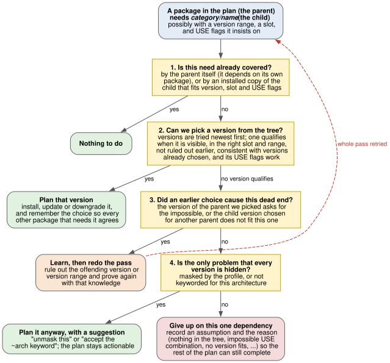
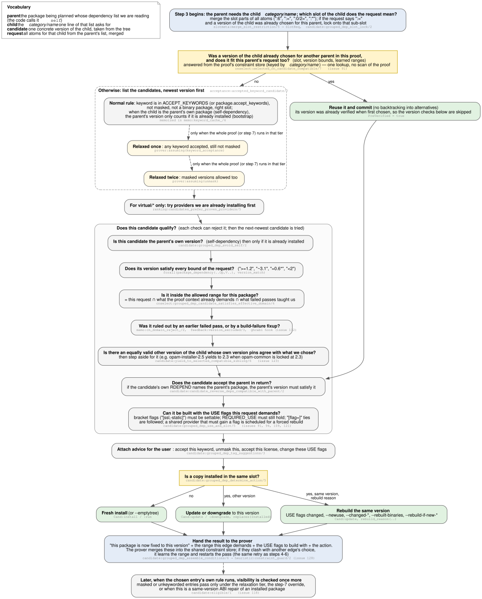

# Resolution: Configuration as Proofs

## Configuration as a first proving pass

The prover ([Chapter 8](08-doc-prover.md)) answers a question about the
**final world**: which packages, which versions, which USE flags?  Pass 1
gives that *what* the same status that pass 2 gives the *when*
([Chapter 13](13-doc-planning.md)): **the configuration is a proof**.

`resolver:resolve/9` hands the `resolving` rule set to
`prover:prove/10`.  Every chosen candidate, every USE-conditional branch
taken or skipped, every OR-group arm, and every domain assumption is
justified by a `resolving:rule/2` expansion (or by an explicit prover
cycle break).  There is no separate "resolver algorithm" whose output
must later be trusted — the Proof / Model / Constraints / Triggers
quadruples *are* the justified configuration.

The rules contract and the multi-module picture are in
[Chapter 11](11-doc-rules.md).  This chapter is the Gentoo resolve pass
in depth: how a user target becomes an installed graph, how candidates
and USE are chosen, and what happens when the rules layer must propose
a configuration change.


## How dependency resolution works (end-to-end)

A typical run starts with a user query like `sys-apps/portage`.  The
rules layer turns this into a `target/2` literal and resolves it to
the best eligible candidate — the newest version that is not masked,
has an accepted keyword, and satisfies any slot constraints.  This
resolution produces sub-literals that drive the rest of the proof.

The resolution then branches depending on the action:

- **`:run`** resolves runtime dependencies (RDEPEND).  PDEPEND is
  handled in the same pass through the prover's proof-obligation hook
  (see [Hooks](#hooks)).
- **`:install`** resolves build-time dependencies (DEPEND and BDEPEND)
  and attaches ordering markers (`after/1`) that express which
  packages must be installed before others.

Each dependency atom from the metadata becomes a
`grouped_package_dependency` literal.  The candidate selection
machinery then applies version ranges, slot operators, keyword and
mask policy, and any learned constraints from prior reprove attempts
(see [Chapter 9](09-doc-prover-assumptions.md) and
[Chapter 10](10-doc-version-domains.md)).

USE-conditional dependencies are included only when the condition
holds in the effective USE set for that ebuild and path.  For example,
`ssl? ( dev-libs/openssl )` adds `dev-libs/openssl` to the body only
if `ssl` is enabled; otherwise the branch is skipped entirely.  When a
parent requires particular flags on a child, those requirements
propagate via `build_with_use` in the proof-term context (see
[USE flags in depth](#use-flags-in-depth)).

The prover walks this structure depth-first: each successful rule
expansion adds literals to the proof and updates the model.  When a
rule fails, Prolog backtracks to try an alternative candidate or,
ultimately, records an assumption.


## The `resolving:rule/2` head patterns

The resolve pass uses the shared `rule/2` contract
([Chapter 11](11-doc-rules.md)) with Gentoo heads:

```prolog
resolving:rule(+Head, -Body)
```

Target rules translate a user query into a concrete ebuild.  Action
rules (`:install`, `:run`, `:download`) expand an ebuild into its
dependency obligations.  Dependency rules resolve individual atoms to
candidates.  Validation rules enforce REQUIRED_USE constraints.  The
catch-all `assumed(X)` clause handles domain assumptions when no real
rule applies.

| **Head pattern** | **Purpose** |
| :--- | :--- |
| `target(Q, Arg):run` | Resolve a user target to a candidate ebuild (`--merge`, `--fetchonly`) |
| `target(Q, Arg):fetchonly` | Legacy fetch-only target (CLI `--fetchonly` proves `:run` instead) |
| `target(Q, Arg):uninstall` | Uninstall target resolution |
| `Repo://Ebuild:install` | Build and install an ebuild (DEPEND + BDEPEND) |
| `Repo://Ebuild:run` | Runtime availability (RDEPEND) |
| `Repo://Ebuild:download` | Fetch source archives |
| `Repo://Ebuild:fetchonly` | Legacy fetch-only ebuild action |
| `Repo://Ebuild:depclean` | Remove unneeded package |
| `grouped_package_dependency(...):Action` | Resolve a grouped dependency |
| `package_dependency(...):config` | Configure a single dependency |
| `exactly_one_of_group(...):validate` | Validate REQUIRED_USE `^^` |
| `any_of_group(...):validate` | Validate REQUIRED_USE any-of |
| `at_most_one_of_group(...):validate` | Validate REQUIRED_USE `??` |
| `assumed(X)` | Catch-all for domain assumptions |


## Candidate resolution

Every dependency line in an ebuild has to become one concrete package
in the plan.  This section explains how that choice is made, first
from a helicopter, then step by step.  The implementation is spread
over `target.pl`, `candidate.pl`, `cnselect.pl`, `acceptance.pl` and
`ranking.pl` (see [Rules submodules](#rules-submodules)); the diagrams
name the predicate behind each box in small grey type so the prose
can be followed into the source.

Four words are used throughout:

- **parent** — the package being planned whose DEPEND / RDEPEND /
  BDEPEND / PDEPEND list we are reading.  It is either what the user
  asked for, or a package an earlier step already put in the plan;
  every planned package in turn becomes the parent of its own
  dependency lines.  The source code calls the parent `self`: it is
  carried in the proof-term context as `self(Repo://ParentEntry)`,
  meaning "the package this proof step is about".
- **child** — the `category/name` one line of that list asks for.
  All atoms for the same child are merged into one *request*
  (`grouped_package_dependency(Strength, C, N, Atoms)`).
- **candidate** — one concrete version of the child, taken from the
  tree.
- **self-dependency** — a line where the child is the parent's own
  package (an ebuild depending on itself, e.g. a bootstrap compiler).

What the user typed on the command line is not a dependency line and
does not go through this machinery: `target:resolve_candidate/2`
binds the query to the newest visible ebuild (visible first, then all
candidates, so relaxation tiers can reach masked ones), and that
ebuild's `:run` or `:install` rule becomes the first parent.
Everything below is about the dependency lines of a parent.

### The helicopter view: four questions

For every request the resolver asks the same four questions, in order.
The first question answered *yes* ends the matter.

1. **Is this need already covered?**  By the parent itself (a runtime
   self-dependency), or by an installed copy of the child that fits
   the version range, the slot and the required USE flags — and that
   nobody asked to rebuild.  If so, nothing is merged.
2. **Can we pick a version of the child from the tree?**  Candidates
   are tried newest first.  One qualifies when it is visible
   (keyworded, not masked), in the right slot and range, not ruled
   out by an earlier failed pass, consistent with the version already
   chosen for the same child elsewhere in the proof, and buildable
   with the USE flags the request demands.  The first qualifying
   candidate is planned, and the choice is remembered so every other
   parent that needs this child agrees on it.
3. **Did an earlier choice cause this dead end?**  If no candidate
   qualifies because the version we picked for the *parent* asks for
   something impossible, or because the child version already chosen
   for *another* parent does not fit this one, the resolver learns a
   lesson — a version range to avoid, or an exact version to reject —
   and **restarts the whole pass** with that knowledge.  This is why a
   plan can take several passes.
4. **Is the only problem that every version is hidden?**  If all
   candidates are merely masked or not keyworded for this
   architecture, one is planned anyway and the plan carries a
   suggestion ("unmask this", "accept ~arch"); the plan stays
   actionable.  Otherwise the resolver gives up on *this one request*,
   records an assumption with the reason (nothing in the tree,
   impossible USE combination, no version fits) and lets the rest of
   the plan complete.



All four questions read and write the same shared memory: the versions
already chosen in this proof (the `selected_cn(C,N)` entries of the
prover's constraint store — an AVL keyed by package, so "already
chosen?" is a logarithmic lookup, never a walk over the proof; one
entry per child, so two parents never pull two versions of one child
into the same slot); the
lessons from failed passes (learned `cn_domain` ranges and the reject
map, [Chapter 10](10-doc-version-domains.md)); the user's
configuration (masks, keywords, USE, licenses); and the relaxation
tier, i.e. how far that configuration may be bent in this attempt
([Chapter 9](09-doc-prover-assumptions.md#progressive-relaxation)).

### The decision ladder: eight steps

`candidate:resolve(grouped_dep(C,N,Atoms):Action?{Context}, Conditions)`
in `target.pl` is an eight-clause ladder.  Each clause is tried in
order; the first that succeeds decides the outcome, and a clause that
is "not applicable" simply fails through to the next.  Steps 1–3 answer
"already covered?" and "pick a version"; steps 4–6 are three different
lessons the resolver can learn before restarting; steps 7–8 are the
fallbacks when there is nothing left to learn.

| **Step** | **In plain words** | **Predicate** |
| :--- | :--- | :--- |
| 1 | Is this a runtime self-dependency?  The child is the parent's own package and the request is for runtime: the parent provides it itself once merged, so there is nothing to do. | clause 1, `memberchk(self(..), Context)` |
| — | Tighten the request with the parent's own RDEPEND bounds (install-time requests only): if the parent's RDEPEND *also* names this child with a version range, add it now so we never pick a child version the parent will reject at runtime. | `candidate:augment_package_deps_with_self_rdepend/6` |
| 2 | Does an installed copy of the child already do the job?  Same slot, every version bound holds, required USE flags are built in (PDEPEND ignores USE drift), and no rebuild was requested (`--newuse`, `--changed-use`, `--changed-deps`, `--changed-slot`, `--rebuilt-binaries`, `--rebuild-if-new-*`).  Skipped under `--emptytree` and for `--exclude`d packages. | `candidate:grouped_dep_keep_installed/5` |
| 3 | Pick a version of the child from the tree (next section).  On success the proof gains the chosen entry and its action, the `selected_cn` commitment, the `cn_domain` range this request demands, and the `build_with_use` flags. | `candidate:grouped_dep_select_and_build/6` |
| — | Guard before learning anything: not when the failure is a USE / REQUIRED_USE clash already recorded, and not when a shared provider is about to be rebuilt with a forced USE flag — that rebuild may fix it (#94). | `\+ memo:requse_violation_/3`, `\+ memo:bwu_force_pending_/3` |
| 4 | Was it a wildcard range we can learn as a hard bound?  `=pkg-6.31*` becomes a learned range `[6.31, 6.32)` for the child — if the parent has only one version or was already narrowed; otherwise step 5 goes first (#126). | `cnselect:maybe_learn_wildcard_domain/4` |
| 5 | Blame the parent: this version of the parent asks for something no child version can give.  Reject exactly this parent version so the retry picks the next one.  Not done for PDEPEND, for a slot not met yet, when the child itself can be re-chosen, when the only problem is visibility, or when the parent is what the user asked for. | `cnselect:maybe_learn_parent_narrowing/4` |
| 6 | Blame an earlier choice: the version of the child already chosen for another parent does not fit this one.  Reject that chosen version (or the package whose blocker introduced the conflict) and retry. | `cnselect:maybe_request_grouped_dep_reprove/5` |
| 7 | Is the only problem that every version is hidden (masked, or not keyworded)?  Rerun step 3 while pretending the visibility rule is relaxed for this one request, remember that the entry may pass its own visibility check, and tag the plan with "unmask" or "accept keyword" (#14). | `candidate:grouped_dep_concretize_hidden/7`, `memo:visibility_override_/2` |
| 8 | Give up on this request, but say why.  The proof continues with a domain assumption that carries the reason and the best suggestion. | `candidate:grouped_dep_build_assumption/7` |

Steps 4, 5 and 6 all end in
`throw(prover_reprove(cn_domain(C, N, Domain, Rejected, Reasons)))`,
which the prover catches to restart the pass with the learned range or
rejection in place (the reprove loop of
[Chapter 9](09-doc-prover-assumptions.md#reprove-mechanism)).

```{=typst}
#page(flipped: true, margin: (left: 15mm, right: 15mm, top: 20mm, bottom: 20mm))[
  #set text(size: 9pt)
  #align(center + horizon)[
    #text(font: "Helvetica Neue", size: 14pt, weight: "bold")[Candidate selection: the eight-step decision ladder]
    #v(8pt)
    #image("Diagrams/12-candidate-ladder.svg", width: 100%, height: 150mm, fit: "contain")
  ]
]
```

### Inside step 3: picking a version from the tree

`candidate:grouped_dep_select_and_build/6` works top to bottom:

1. **Which slot of the child does the request mean?**  The slot parts
   of all atoms (`:6`, `:=`, `:0/2=`, `:*`) are merged into one slot
   requirement (`slotmeta:merge_slot_restriction/5`).  If the request
   says `:=` and a version of the child was already chosen for this
   parent, the request locks onto that sub-slot
   (`grouped_dep_slot_lock/2`).
2. **Was a version of the child already chosen for another parent, and
   does it fit this request too?**  This is one lookup in the proof's
   constraint store, not a scan of the proof: every committed choice is
   a `selected_cn(C,N)` entry in the prover's constraint store (an AVL
   keyed by package), mirrored into the `memo_selected_cn_snap` store by
   `heuristic:constraint_guard/2` so rule code can read it without the
   store in hand.  A fitting entry is reused and committed without
   backtracking into alternatives
   (`cnselect:selected_cn_candidate_compatible/7`, #91).  Its version
   was verified when first chosen, so the version checks below are
   skipped; the reverse-dependency and USE checks still run.
3. **Otherwise list the candidates, newest version first**
   (`acceptance:accepted_keyword_candidate/7`).  Under the normal rule a
   candidate must carry a keyword in `ACCEPT_KEYWORDS` (or
   `package.accept_keywords`), be unmasked, not be a binary package and
   sit in the requested slot; when the child is the parent's own
   package (self-dependency) the parent's version only counts if it is
   already installed (bootstrap).  Under `prover:assuming(keyword_acceptance)`
   any keyword is accepted; under `prover:assuming(unmask)` masked
   versions are listed too.  For `virtual/*` children, providers already
   being installed are tried first
   (`ranking:candidates_prefer_proven_providers/5`).
4. **Does this candidate qualify?**  Each check can reject it, after
   which the next-newest candidate is tried:
   - Is it the parent's own version (self-dependency)?  Then only if
     already installed (`grouped_dep_avoid_self/2`).
   - Does its version satisfy every bound of the request
     (`>=1.2`, `~3.1`, `=0.6*`, `<2`)?
   - Is it inside the allowed range for the child — this request ∩
     what the proof context already demands ∩ what failed passes taught
     us (`cnselect:grouped_dep_candidate_satisfies_effective_domain/6`)?
   - Was it ruled out by an earlier failed pass or by a build-failure
     fixup (`memo:cn_domain_reject_/2`, `feedback:version_excluded/3`,
     the `ghcabi` hook, #112)?
   - Is there an equally valid other version of the child whose own
     version pins agree with what we already chose?  Then step aside
     for it (`yield_to_selected_compatible_sibling/6`, #123).
   - Does the candidate accept the parent in return?  If its own
     RDEPEND names the parent's package, the parent's version must
     satisfy it (`candidate_reverse_deps_compatible_with_parent/2`).
   - Can it be built with the USE flags the request demands?  Bracket
     flags must be settable, REQUIRED_USE must still hold, `[flag=]`
     ties are followed, and a shared provider that must gain a flag is
     scheduled for a forced rebuild (`grouped_dep_use_and_slot/5`;
     #91, #94, #109, #121).
5. **Attach advice for the user** — accept this keyword, unmask this,
   accept this license, change these USE flags
   (`grouped_dep_tag_suggestions/3`).
6. **Is a copy installed in the same slot?**  No: fresh install (or
   `--emptytree`).  Yes, other version: update or downgrade.  Yes, same
   version with a rebuild reason (USE change, `--newuse`,
   `--changed-*`, `--rebuilt-binaries`, `--rebuild-if-new-*`): rebuild
   (`grouped_dep_determine_action/5`).
7. **Hand the result to the prover** (`grouped_dep_assemble_conditions/6`):
   the `selected_cn` commitment, the `cn_domain` range this request
   demands, the `build_with_use` flags and the action literal.  The
   prover merges these into the shared constraint store through
   `heuristic:constraint_guard/2`; if they clash with another request's
   choice, it learns the range and restarts the pass — the same retry
   as steps 4–6 of the ladder (#128).

Visibility is checked once more when the chosen entry's own rule runs:
`candidate:eligible/1` lets a masked or unkeyworded entry pass only
under the active relaxation tier, the step-7 override, or when the
merge is a same-version ABI repair of an installed package (#118).



### Dependency ordering within a group

Before proving the dependencies of a parent, `ranking:dep_priority/2`
sorts them so that tightly constrained siblings are proved first.  This
reduces greedy conflicts where an unconstrained sibling selects a
version that later clashes with a tighter constraint.  The order is
declared, not weighted: `ranking:tightness_classes/1` is an ordered
list of classes, and a request is proved in the position of the
*first* class that applies to it.

| **Class** | **Request looks like** |
| :--- | :--- |
| `subslot_pinned` | `dev-libs/foo:0/2=` — slot and sub-slot given |
| `upper_bounded` | `>=dev-libs/foo-1.0 <dev-libs/foo-2.0` — tight upper bound (tighter bound first) |
| `tilde` | `~dev-ruby/railties-8.1.1` |
| `slot_pinned` | `dev-libs/foo:3` |
| `wildcard` | `=dev-python/gast-0.6*` |
| `any_same_slot` | `dev-libs/foo:=` |
| `any_different_slot` | `dev-libs/foo:*` |
| `unconstrained` | `dev-libs/foo` |

Classes earlier in the list are proved first, so slotted, tilde and
wildcard requests lock their `selected_cn` before unconstrained
siblings pick a potentially conflicting version.  Nothing but the
position in that list encodes the order.

### Self-dependencies and cross-slot handling

When a parent lists its own package as a build dependency (e.g.
`antlr-tool:4` needing `antlr-tool:3.5` to bootstrap), the rules layer
distinguishes **same-slot self-dependencies** from **cross-slot
self-dependencies**.

Same-slot self-dependencies (same category, name, and slot as the
parent) are treated as bootstrap dependencies: if the package is
already installed, the dependency is satisfied; otherwise the rule
fails so that backtracking can reach a bootstrap alternative.

Cross-slot self-dependencies (same category and name but a *different*
slot) are treated as **regular requests** and resolved through the
ladder normally.  This prevents model build failures when the
cross-slot version is not yet installed.


## Cycles and how portage-ng handles them

Circular dependencies are a fact of life in the Portage tree.  A
language runtime may be packaged with tooling that itself depends on
that runtime, creating a loop.  The prover detects these cycles during
its depth-first proof search: it keeps track of which literals are
currently being proved, and if the same literal appears again while it
is still on the stack, a cycle has been found.

Before breaking a cycle with an assumption, the prover asks the domain
whether the cycle is **benign**.  The hook `heuristic:cycle_benign/2`
inspects the repeating literal and the cycle path.  If the hook
succeeds, the literal is treated as already justified and added to the
model without a cycle-break assumption.  If the hook fails, the prover
records a cycle-break assumption (`assumed(rule(Lit))` in the proof,
`assumed(Lit)` in the model).  This is separate from domain
assumptions introduced by `rule(assumed(X), [])`.

The benign classification is conservative and pattern-based.  For
example, cycles that pass through `:run` (RDEPEND paths) are often
treated as ordering-style cycles rather than hard failures — mirroring
how traditional resolvers tolerate certain cyclic patterns.

After the proof is complete, the ordering pass
([Chapter 13](13-doc-planning.md)) resolves cyclic portions of the
graph by citing the installed world (VDB) where possible, so that the
merge ordering respects the cycle structure.  For more on proof search
and assumptions, see [Chapter 8](08-doc-prover.md) and
[Chapter 9](09-doc-prover-assumptions.md).


## USE flags in depth

USE flags play a central role in dependency resolution.  They determine
which dependency branches exist, which packages are eligible, and
whether REQUIRED_USE constraints are satisfied.

### Effective USE and conditionals

For each ebuild the rules layer computes an **effective USE set** — the
final set of flags that are active for this particular proof path.
USE-conditional dependencies like `ssl? ( dev-libs/openssl )` are
evaluated against this set: if the flag is active, the dependency is
included; otherwise it is skipped.

The key predicate is `use:effective_use_for_entry/3` (with the context
wrapper `use:effective_use_in_context/3`), which computes the full
effective USE set for an ebuild.  Whether a USE-conditional group is
active is decided by the `candidate:eligible(use_conditional(...))`
clauses together with the `use_conditional_group` rules in
`resolving.pl`.

### `build_with_use`

When a parent dependency requires specific USE flags on a child (e.g.
`dev-libs/openssl[threads]`), those requirements travel through the
proof as `build_with_use` context annotations.  They influence how the
child's effective USE set is computed, ensuring that parent
requirements are not silently ignored.

### `REQUIRED_USE`

Gentoo's REQUIRED_USE expressions (e.g. `^^ ( gtk qt5 )` meaning
"exactly one of gtk or qt5") are enforced through dedicated validation
literals.  If the active USE set violates a REQUIRED_USE expression,
the rule fails and the prover backtracks to try another candidate or
records an assumption (see
[Chapter 9, section 9.8](09-doc-prover-assumptions.md#use-model-violation-flow)).

### Priority order

USE flags are resolved in priority order, highest priority first:

1. **`build_with_use`** from the parent's dependency context
2. **User configuration** (`/etc/portage/package.use`)
3. **Profile defaults**
4. **Ebuild IUSE defaults**

The most important consequence is that context wins over profile
defaults: a `build_with_use` requirement from the parent can force or
forbid a flag regardless of what the profile would normally choose.
This is why two proofs for the same package can produce different USE
sets — they arrive through different dependency paths with different
context annotations.

### Conflicts and backtracking

When USE-derived constraints conflict — for example, REQUIRED_USE
fails, a conditional branch does not apply as expected, or an
eligibility check fails — the relevant rule fails.  The prover then
backtracks: it tries another candidate version, another slot, or
another branch of the search tree.  If no alternative succeeds, the
candidate layer records a domain assumption, often tagged with a
suggestion for which `package.use` change would resolve the conflict
(see [Assumptions as proposals](#assumptions-as-proposals)).

## Choice groups

Gentoo's PMS defines three choice-group operators that constrain how
many members of a set may be active at the same time.  The rules layer
maps each operator to a dedicated validation literal that the prover
must satisfy as part of the proof:

| **Operator** | **Rule clause** | **Semantics** |
| :--- | :--- | :--- |
| any-of ( a b c ) | `any_of_group(Deps):validate` | At least one must be satisfied |
| `^^ ( a b c )` | `exactly_one_of_group(Deps):validate` | Exactly one must be satisfied |
| `?? ( a b c )` | `at_most_one_of_group(Deps):validate` | At most one may be satisfied |

If the validation literal fails (e.g. two members of an
`exactly_one_of` group are both active), the prover backtracks to try
a different USE configuration or candidate version.

When a disjunctive dependency group (`||`, `^^`, `exactly_one_of`) must
*select* an alternative, the candidate layer ranks the members with
`ranking:prioritize_deps_keep_all/3` and commits to the first arm that
passes config checks (see [Any-of (`||`) arm selection](#any-of-arm-selection)
below).  Profile-forced and installed preferences still dominate via
`is_preferred_dep/2`, the leading signal of the `preference` criterion;
USE_EXPAND target digits (`ranking:use_expand_target_key/2`) are its
last signal and also feed `use_expand` — `llvm_slot_20` → `[20]`,
`python_single_target_python3_13` → `[3,13]`, and so on.


## Any-of (`||`) arm selection {#any-of-arm-selection}

Gentoo ebuilds often write `|| ( arm1 arm2 … )`.  The PMS only requires
that *at least one* arm is satisfiable; it does not say which arm to
pick.  Wrong order locks the prover onto a suboptimal (or incompatible)
branch — for example cabal’s
`|| ( ( >=text-1.2.3 <text-1.3 ) ( >=text-2 <text-2.2 ) )` must prefer
the text-2.x arm when that is the newest tree candidate
(portage-ng#112).

### Portage vs portage-ng entry points

| | **Portage** | **portage-ng** |
| :--- | :--- | :--- |
| Mechanism | `dep_zapdeps` ordered `choice_bins` + intra-bin upgrade promotion (`lib/portage/dep/dep_check.py`) | `candidate:resolve(choice_group…)` → `ranking:prioritize_deps_keep_all/3` then first `any_of_config_dep_ok` |
| Structure | Nine preference bins (lists) | One declared criterion list (`ranking:choice_criteria/1`), compared lexicographically by standard order of terms, original index last |
| Graph reuse | Digraph `all_in_graph` | `selected_cn` snapshot (`snap_all`) |

Ranking *is* the preference policy: after the cut commits, later arms
are not tried unless the proof backtracks for another reason.

### Preference criteria (most significant first)

Declared as `ranking:choice_criteria/1`; each criterion's value comes
from `ranking:criterion_value/5` and `prioritize_deps_keep_all/3`
compares arms criterion by criterion (`ranking:compare_preference/3`)
using the standard order of terms — a *larger* value is preferred, and
the original ebuild index breaks remaining ties (left-to-right).  There
is no weighted sum and no integer packing: booleans are `no @< yes`,
counts are integers, versions are `version/7` terms (which compare as
PMS versions), slots and USE_EXPAND targets are digit-group lists
(`'3.10'` → `[3,10]` `@>` `[3,3]`), and `none` sorts below everything
else.  Adding a preference means adding a criterion to the list, not
choosing a magnitude.

| **Criterion** | **Value** | **Intent** | **Emerge analogue** |
| :--- | :--- | :--- | :--- |
| `license_ok` | `yes`/`no` | Prefer license-acceptable arms | Availability / license gate |
| `use_sat` | `yes`/`no` | Prefer arms needing no USE flip on the arm’s best candidate | `preferred_*` vs `unsat_use_*` |
| `use_unmasked` | `yes`/`no` | Among USE-unsat arms, prefer flips that do not fight use.mask / use.force | `all_use_unmasked` (masked → `other`) |
| `preference` | `pref/6` | Installed / profile-preferred, `--favour` / `--avoid`, not self-CN, no forced upgrade, `-bootstrap`, USE_EXPAND target — in that order, as the six arguments of one compound | `preferred_installed` + favour |
| `snap_all` | `yes`/`no` | Prefer arms whose non-`virtual/` CNs are already in the proof snapshot | `all_in_graph` |
| `snap_admits` | `yes`/`no` | Prefer an arm whose version bounds admit the already-selected candidate. Vacuous when that CN is not selected yet (so `version` still picks the newest arm) and, for a `pkg:N` atom, when nothing is selected in slot `N` | Selected atom vs arm bounds |
| `slot` | digit list / `none` | Prefer higher explicit package slot (`pkg:N`) — only active when *all* arms target the same (C,N) | `want_update` / higher-slot promotion |
| `no_downgrade` | `yes`/`no` | Demote arms whose newest admitted version is below installed or snap-selected | `downgrade_probe` → `other` |
| `installed` | count | Prefer arms that reuse more installed CNs | `other_installed` / `_some` / `_any_slot` |
| `overlap` | count | Prefer arms that appear in several sibling `\|\|` groups | Soft stand-in for minimize-slots pressure |
| `version` | `version/7` / `version_none` | Prefer the arm that admits the newest tree version — only active when *all* arms target the same (C,N) | Intra-bin `has_upgrade and not has_downgrade` |
| `use_expand` | integer | Prefer USE_EXPAND profile alignment (+1 per matching target, −1 per mismatch) | Profile target preference |
| ebuild index | integer, ascending | Stable left-to-right when all else equal | Ebuild order fallback |

Worked examples:

- `|| ( foo[a] foo[b] )` with `a` already effective → `use_sat` picks `foo[a]`.
- Cabal text ranges (above) → `version` picks the text-2.x arm when neither is selected. Once text-1.2.5.0 is selected, `snap_admits` keeps the 1.2 arm (portage-ng#123).
- `|| ( sys-devel/llvm:18 sys-devel/llvm:20 )` → `slot` prefers `:20`.
- An arm whose packages are already in `selected_cn` beats a fresh CN → `snap_all`.

The same pattern orders the *proof* of a package's dependencies:
`ranking:dep_priority/2` sorts sibling deps by their position in the
declared `ranking:tightness_classes/1` list (sub-slot pin, tight upper
bound, tilde, slot pin, wildcard, any-same-slot, any-different-slot,
unconstrained, …), taking the first class that applies, so the tightest
constraint locks `selected_cn` before a looser sibling can pick a
conflicting version.

`version` and `slot` are gated to same-CN groups because
comparing newest tree versions — or highest slots — of *different*
packages is meaningless and overrides ebuild order: `virtual/mta`
would pick `notqmail` (a `-9999` live ebuild inflates its score) over
the intended `nullmailer`, and `virtual/jdk` would pick source
`dev-java/openjdk` over `openjdk-bin` (portage-ng#115,
portage-ng#116).  Ungated slot-ranking likewise flipped ruby-single
choices: `( ruby:3.3 rubygems[ruby33] )` — the profile default, listed
first — lost to `( ruby:4.0 rubygems[ruby40] )` because 4.0 > 3.3,
scheduling the `~arch` ruby:4.0 slot plus a `ruby_targets_ruby40` USE
toggle that emerge never takes (webkit-gtk build cluster, Aug-2026
tinderbox run).  Emerge never version- or slot-ranks across CPs inside
a choice; it falls back to ebuild order there.

`virtual/` atoms are skipped for `snap_all`, `installed`, and
`no_downgrade` (Portage’s zero-cost treatment of virtuals in those
checks).  Scores are computed once per arm per
`prioritize_deps_keep_all/3` call, with a short-lived per-call cache for
installed / reference-version lookups.  Ranking must not walk the
ProofAVL; it only sees the proof-context list and memo snapshots
(see also [Chapter 27](27-doc-performance.md)).

### What we deliberately do not implement

These Portage mechanisms are **design omissions**, not open bugs.  The
inductive prover and ordering pass already provide the effects they target.

**Overlapping-`||` DNF (`_overlap_dnf`) and `minimize_slots` /
`new_slot_count`.**
Portage merges overlapping `||` groups that share a CP into DNF, then
sorts bins by ascending new-slot count.  portage-ng does not rewrite
the dep tree into DNF: expansion is exponential in overlapping width and
does not belong on the per-`choice_group` hot path.  The prover already
commits `selected_cn` / learned `cn_domain` across the proof; later `||`
sites reuse those choices via `snap_all` and constraint guards — the same
“prefer packages already chosen” effect without a cross-product.
`overlap`, `installed`, and `snap_all` cover the common “don’t pull a
second redundant package” pressure.  Remaining edge cases (two
overlapping `||`s neither yet selected) are rare relative to cost; if
tinderbox surfaces one, prefer a targeted heuristic over full DNF.

**Virtual expand (`_expand_new_virtuals`).**
Portage expands new-style virtuals into a newest-first `||` of providers
before zapdeps.  portage-ng already resolves virtuals through the
virtual-provider path and `candidates_prefer_proven_providers/5`, and
skips `virtual/` in the scores above.  A second expand-into-`||` pass
would duplicate that work and fight proven-provider reuse.

**Circular-dep demotion inside `||`.**
Portage demotes arms that close a known cycle with the parent (or
`--onlydeps` parent CP) into `other`.  portage-ng handles cycles in the
prover and the ordering pass (cycle-break assumptions, world citations,
`unreachable` assumptions) — see [Chapter 8](08-doc-prover.md),
[Chapter 9](09-doc-prover-assumptions.md), and
[Chapter 13](13-doc-planning.md).  Demoting at ranking time would
second-guess cycle-break polarity and needs a parent circular map that
the proof-context list does not carry.

**Intra-choice `cp_map` slot consistency (Portage bug 600346).**
Portage keeps a per-choice CP→slot map so several atoms in one choice
stay slot-consistent.  portage-ng arms are usually a single atom or a
same-CN `all_of_group` of version bounds; cross-CP multi-atom arms that
need `cp_map` are uncommon.  Slot consistency is enforced later by
`selected_cn`, slot constraints, and constraint guards.

### Validation

- PLUnit: `ranking_any_of_version_branch`, `ranking_any_of_preference_keys`
  in `Source/Test/Unit/rankingtest.pl`.
- Overlay suite (`||` / USE / slot cases) and tinderbox-ng compare on
  USE-dep `||` and llvm/gcc/python slot packages.


## Slot operators

Dependency atoms can carry a slot operator that tells the rules layer
how to handle multi-slot packages.  A package like `dev-lang/python`
may offer several slots (e.g. `3.11`, `3.12`), and the slot operator
determines which slots are acceptable and whether a sub-slot change
should trigger a rebuild of the dependent package.

| **Operator** | **Meaning** | **Context effect** |
| :--- | :--- | :--- |
| `:SLOT` | Depend on a specific slot | Filters candidates to that slot |
| `:*` | Any slot is acceptable | No slot constraint applied |
| `:=` | Sub-slot rebuild trigger | Records the selected sub-slot; a change triggers rebuild |
| `:SLOT=` | Specific slot + rebuild | Combines slot filter with rebuild tracking |


## Blockers

A blocker dependency says that two packages cannot coexist.  Gentoo
distinguishes two strengths:

| **Type** | **Syntax** | **Behaviour** |
| :--- | :--- | :--- |
| Soft blocker (PMS: *weak*) | `!cat/pkg` | The blocked package should not be present; never fails the proof — walked past, recorded, and reported as an actionable assumption when effective |
| Hard blocker (PMS: *strong*) | `!!cat/pkg` | The blocked package must not be present; the constraint guard fires immediately |

Plan output says *soft* / *hard*; the rules name the atoms `weak` /
`strong` after the PMS syntax.  A soft blocker is the negative
counterpart of an ordering preference — see the terminology box in
Chapter 13 ("Dependency types and ordering strength").

Internally, blockers produce `blocked_cn` constraint terms.  These are
checked against `selected_cn` constraints by
`selected_cn_not_blocked_or_reprove`: if the blocked package has
already been selected elsewhere in the proof, the guard triggers a
reprove so the prover can learn to avoid the conflicting combination
(see [Chapter 9, section 9.10](09-doc-prover-assumptions.md#constraint-guards-and-reprove-integration)).


## Hooks

PDEPEND (post-dependencies) represent packages that should be present
at runtime but are not required at build time.  Unlike DEPEND and
RDEPEND, they do not block the build — they are installed afterwards.

In portage-ng, PDEPEND is handled in a single pass inside the prover
via the `heuristic:proof_obligation/4` hook.  Whenever a literal is
successfully proved, the hook checks whether the corresponding ebuild
has PDEPEND entries.  If it does, those entries are injected as
additional proof obligations on the spot.  This avoids a separate
PDEPEND resolution pass and ensures that post-dependencies are part of
the same proof and plan.


## Assumptions as proposals

When strict resolution cannot satisfy every dependency, the rules
layer records a **domain assumption** rather than giving up.  From a
user perspective, an assumption is not a dead end — it is a
**proposal** for a configuration change.

The literal's proof-term context is annotated with **suggestion** tags
that spell out exactly what to change.  Common suggestions include:

- `suggestion(unmask, ...)` — unmask a package
- `suggestion(accept_keyword, ...)` — accept an unstable keyword
- `suggestion(use_change, ..., Changes)` — adjust USE flags

The printer collects these tags and shows them next to the assumption,
so you can see which `/etc/portage` file to edit and what to put in
it.  The plan is still constructed as if the change had already been
applied: the merge list is coherent under the stated proposal, and the
output tells you which configuration changes would make it real.

For the full story on assumptions and constraint learning, see
[Chapter 9](09-doc-prover-assumptions.md).


## Rules submodules

The `resolving` entry point is not a single monolithic file.  It is
split across focused submodules under
`Source/Domain/Gentoo/Rules/Resolving/`, each handling a distinct
concern:

| **Module** | **File** | **Purpose** |
| :--- | :--- | :--- |
| `acceptance` | `acceptance.pl` | Keyword, mask, and license acceptance; keyword-aware candidate enumeration |
| `candidate` | `candidate.pl` | Grouped-dep resolution pipeline, blocker matching, eligibility protocol |
| `cnselect` | `cnselect.pl` | CN-consistency: selected_cn reuse, CN-domain reject map, learned-domain narrowing |
| `dependency` | `dependency.pl` | Self-entry injection, USE-requirement collection, slot/BWU proof-context propagation |
| `featureterm` | `featureterm.pl` | Proof-context list helpers (`after/1`, strip `build_with_use`, etc.) |
| `heuristic` | `heuristic.pl` | Prover hooks: constraint guard, cycle classification, PDEPEND obligations, reprove state |
| `memo` | `memo.pl` | Thread-local caching declarations, `clear_caches/0` |
| `ranking` | `ranking.pl` | Dependency ordering (`dep_priority/2`), choice-group ranking, BWU memo seeding |
| `slotmeta` | `slotmeta.pl` | Slot canonicalization, restriction merging, constraint queries |
| `target` | `target.pl` | Target resolution, update/downgrade transactions, depclean, `--exclude` helpers |
| `use` | `use.pl` | USE evaluation, conditionals, `build_with_use`, newuse, REQUIRED_USE, BWU conflicts |


## Policy cards (declarative view)

This chapter walks **how** resolution proceeds. For a newbie-oriented
view of **what** Gentoo policy requires — PMS meaning, literals,
owning modules, and short invariants — start here:

- [Policy cards hub](Policy/README.md)
- [Policy by example](Policy/examples.md) — curated overlay curriculum
- [One-page map](Policy/map.md) — `rule/2` head → schema → test → card

Prefer those cards when onboarding or reviewing a rules change; keep
this chapter for the end-to-end narrative and `||` ranking detail.


## Further reading

- [Chapter 11: Rules and Domain Logic](11-doc-rules.md) — the `rule/2`
  contract and how rule modules plug into the prover
- [Chapter 8: The Prover](08-doc-prover.md) — how the prover calls
  `rule/2` and builds the proof
- [Chapter 9: Assumptions](09-doc-prover-assumptions.md) — the
  fallback chain, reprove mechanism, and progressive relaxation
- [Chapter 10: Version Domains](10-doc-version-domains.md) — how
  version constraints feed into candidate selection
- [Chapter 13: Ordering — Plans as Proofs](13-doc-planning.md) — pass 2
- [Policy cards](Policy/README.md) — declarative Gentoo policy surface
